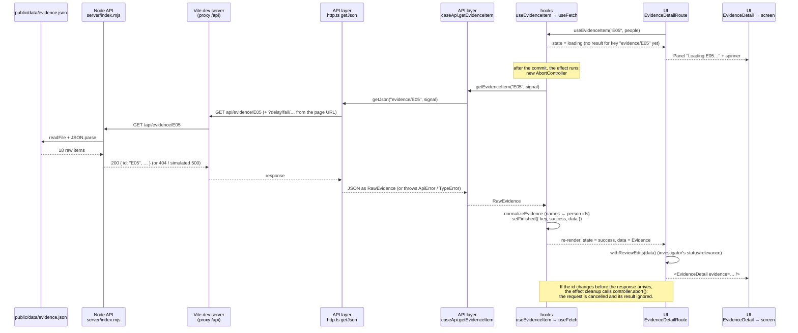

# Data flow: one evidence item, end to end

Example: the investigator clicks the card **E05** in the Evidence Catalogue
(`react.html#/evidence/E05`) while `npm run dev:all` is running.

In a **production build** (GitHub Pages) the steps API → File are replaced by
`fetch("data/evidence.json")` and a lookup by id inside `caseApi.getEvidenceItem`; every layer
above it stays the same.

## What breaks if a step silently stops happening

| Step | If it silently stopped… | How you'd notice |
|---|---|---|
| **Abort in the effect cleanup** | Request races come back: open E01 (slow) then E02 → E01's late response replaces E02. | The detail no longer matches the URL / highlighted card. Reproduce with `?slow=E01&delay=2500` (or `?unsafeRace`). |
| **`normalizeEvidence` in `useEvidenceItem`** | E04 keeps `"Nova Byte"` (a name) in `personIds`. | No visible error at all: E04's "Related people" is just **empty**, because the lookup by id finds nobody. Only noticed by checking E04 or by a test. That's the dangerous kind. |
| **`withReviewEdits` in the route** | The detail shows the original status while the card and Dashboard show the edited one. | Inconsistent badges between list and detail after changing a status. |
| **Vite proxy / backend** | No response at all. | `ErrorState`: "The server could not be reached. Is the backend running (npm run api)?" The failure is visible by design. |
| **`res.ok` check in `getJson`** | A 500's JSON error body would be treated as an evidence item. | The detail renders "undefined" fields or crashes, instead of the error panel. |
